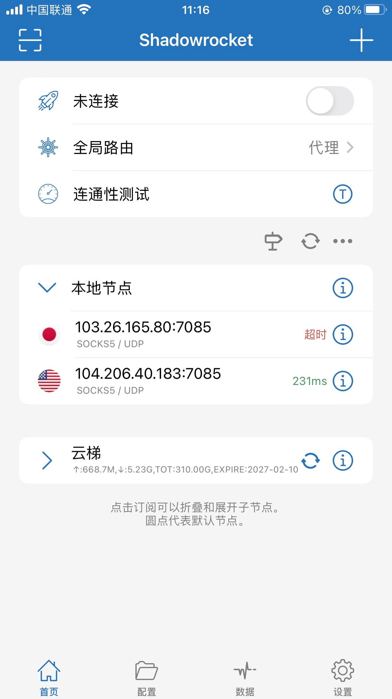
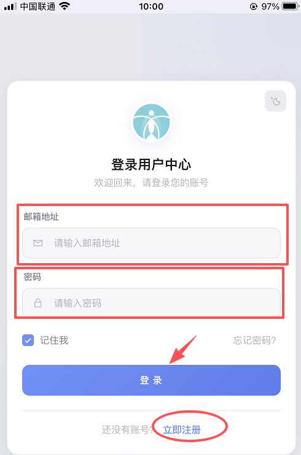
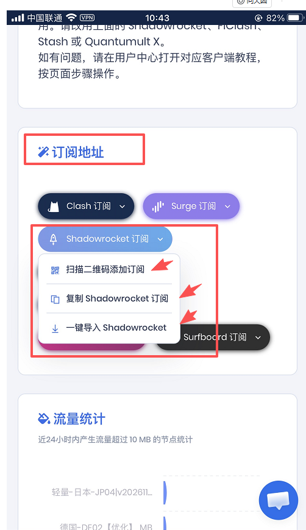
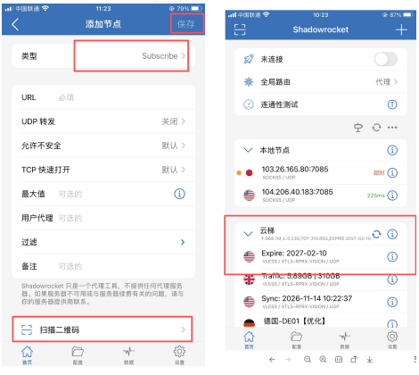
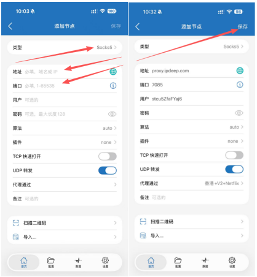
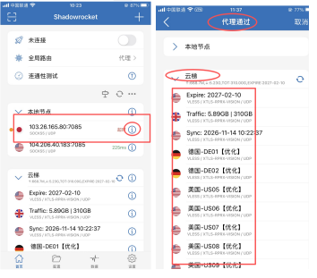
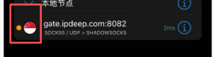

# 苹果手机如何通过两层代理使用Socks5 ip

对于做跨境业务的朋友来说，很多业务场景需要在苹果手机上使用海外Sock5 ip，并且很多Sock5 ip仅支持境外环境使用，那么如何解决呢？

### 以下操作仅为示例，仅供参考：

首先使用美版apple ID登录APP Store

## 下载Shadowrocket应用

## （1）先导入中转代理，如：shadowsocks节点

如果没有shadowsocks节点，可自行购买，购买网站参考（以云梯为例）https://my.ytjscloud.com/auth/login ，或者通过谷歌搜索“shadowsocks节点”进行购买，或者可自备代理节点

在云梯网站点击Shadowrocket 订阅，按自己要求选择下面三种添加方式，已第一种扫码二维码为例，把二维码截图保存到相册。

## （2）添加刚刚购买的云梯节点

(2)Shadoerocket首页>右上角+添加节点>类型>Subscribe>下面扫码二维码。以二维码为例，扫码刚刚存入的照片>保存。

## （3）导入或添加shadowsocks节点成功

点击右上角添加，类型选择Socks5，输入服务器地址、端口、用户名和密码（选填）,保存,会在本地节点模块展示出来。

## （4）选择刚添加的本地节点后面的叹号标志

（3）点击代理通过会展示出shadowsocks节点，选择中国大陆以外的地区后，点击返回，回到添加节点，点击保存

## （5）选择刚添加的本地节点，代理状态改为开启即可

注意：小火箭--您不要以连通性检测按钮或是连接超时为准。
只要输入这个网址：<code>ipaddress.my</code> 查看手机本机IP，就是您购买的IP出口，就是没问题了。
软件自带的那个按钮是不准的 很多人，被这个按钮误导

## 超时问题基本出在：
1. 没有节点或者节点不可用
2. 代理通过没有选择可用节点
3. 没有选中

# 推荐工具
## IP检测工具 —— ToDetect

[ToDetect](https://www.todetect.cn/ip/)是一款专业级浏览器指纹检测工具，可以一键检测IP纯净度、DNS泄露测试、WebRTC检测等浏览器信息，在线免费测试，一键生成检测报告.
